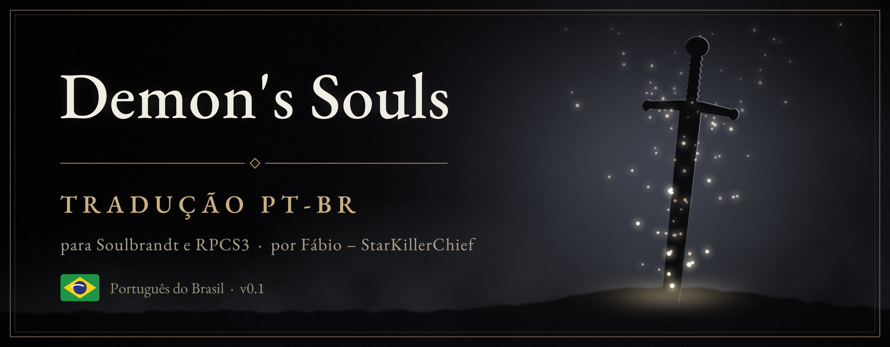
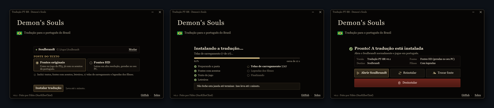

  

  <b>Demon's Souls inteiro em português do Brasil.</b> 
  Menus, itens, magias, diálogos, legendas dos vídeos, letreiros e telas de carregamento, 
  com acentos de verdade nas fontes do próprio jogo, originais ou em HD.

  

  
  
  
  
  

  <a href="#como-instalar">Como instalar</a> ·
  <a href="#o-que-é-traduzido">O que é traduzido</a> ·
  <a href="#fontes-originais-ou-hd">Fontes HD</a> ·
  <a href="#perguntas-frequentes">Perguntas</a> ·
  <a href="#como-ajudar">Como ajudar</a> ·
  <a href="#english-summary">English</a>

> [!IMPORTANT]
> **Nenhum arquivo do jogo vem neste repositório ou no pacote.** Nem textos em inglês, nem fontes, nem imagens.
> O instalador monta tudo no seu PC, a partir da **sua própria cópia** do jogo, e desfaz tudo quando você desinstala.

> [!NOTE]
> **v0.1 é uma versão de teste.** A tradução ainda está sendo revisada: espere algumas frases estranhas e termos que
> ainda vão mudar. Achou algo? [Abra uma issue](../../issues) com um print.

## O que é traduzido

| | |
|---|---|
| ✅ **Menus e textos de sistema** | Inventário, equipamento, status, opções, mensagens na tela |
| ✅ **Itens, armas, armaduras, anéis e magias** | Nomes e descrições, com a terminologia do remake de PS5 sempre que possível |
| ✅ **Diálogos** | Todos os personagens, escritos por nós a partir do inglês |
| ✅ **Legendas dos vídeos** | Abertura e cenas, com moldura no estilo do jogo (só no Soulbrandt) |
| ✅ **Letreiros grandes** | VOCÊ MORREU, DEMÔNIO DESTRUÍDO, ALMA PERDIDA RECUPERADA e os outros |
| ✅ **Telas de carregamento** | Os 17 nomes de personagens e o CARREGANDO, sobre a arte original |
| ✅ **Acentos de verdade** | á, â, ã, à, ç, é, ê, í, ó, ô, õ, ú, nas fontes originais e nas fontes HD feitas no seu PC |

Os acentos são feitos a partir das próprias letras do jogo, para combinar com a fonte original. Os textos foram
medidos contra as caixas de cada tela para não passarem das bordas.

## Onde funciona

| Onde | Situação |
|---|---|
| **Soulbrandt** (PC) | ✅ Suportado. É o jeito recomendado: tudo traduzido, inclusive as legendas dos vídeos. |
| **RPCS3** (emulador) | ✅ Suportado: textos, fontes, letreiros e telas de carregamento (os vídeos ficam sem legendas). |

Por enquanto, só a versão americana do jogo (**BLUS30443**). A versão europeia (BLES00932) ainda não.

## Antes de começar

- **Soulbrandt:** abra o `Soulbrandt.exe` pelo menos uma vez, deixe ele preparar o jogo até o fim e feche.
- **RPCS3:** tenha o Demon's Souls (BLUS30443) na lista de jogos do RPCS3.

Não precisa instalar o Python nem mais nada: tudo o que o instalador usa já vem no pacote.

## Como instalar

1. Baixe o **`PT-BR-Soulbrandt.zip`** na página de [Releases](../../releases).
2. Extraia o zip **dentro da pasta onde está o `Soulbrandt.exe`**. Vai aparecer uma pasta `PT-BR` ao lado dele.
   (Para o RPCS3, pode extrair em qualquer pasta.)
3. Abra a pasta `PT-BR` e dê dois cliques em **`Tradução PT-BR.exe`**.
   Se o Windows mostrar "O Windows protegeu o computador", clique em *Mais informações* → *Executar assim mesmo*.
4. Escolha a fonte, clique em **Instalar tradução** e espere (até 1 minuto). Depois, **Abrir Soulbrandt**.

Para o RPCS3: clique em **Mudar**, escolha **RPCS3** e confirme a pasta do jogo (o instalador tenta achar sozinho).
O mesmo programa troca a fonte, reinstala e desinstala. O passo a passo também está no `LEIA-ME.txt` do pacote.

  
   O instalador. No seu PC, o fundo mostra o logo e as pinturas tirados da sua cópia do jogo.

> [!TIP]
> No Soulbrandt, o instalador nunca altera a pasta original do jogo nem a do RPCS3: ele monta uma pasta própria para
> a tradução e aponta o Soulbrandt para ela. No RPCS3, os arquivos trocados são guardados antes e voltam na
> desinstalação. Os seus saves não são tocados. O logo e as pinturas que aparecem no instalador também vêm da sua
> cópia do jogo.

## Fontes originais ou HD

O instalador pergunta com qual fonte você quer jogar:

- **Fontes originais do jogo**: como no PS3;
- **Fontes HD**: as próprias letras do jogo ampliadas para alta resolução **no seu PC**, já com os acentos.

Não precisa de nenhum mod de fonte, e nada dessas fontes vem no pacote: elas são feitas a partir da sua cópia.
Para trocar de fonte depois, use **Trocar fonte** no instalador. Se você usa algum mod de fonte, ele fica desligado enquanto a
tradução estiver instalada.

## Atualizações e desinstalação

- **O Soulbrandt foi atualizado?** A atualização desfaz a tradução. Abra o Soulbrandt uma vez, deixe ele preparar o
  jogo, feche, abra `Tradução PT-BR.exe` e clique em **Instalar tradução**.
- **Voltar ao inglês:** abra `Tradução PT-BR.exe` e clique em **Desinstalar**.

## Problemas conhecidos

- **Funções novas do Soulbrandt** (por exemplo, a *Respecialization* na estátua) ainda aparecem em inglês: esses textos
  ficam dentro do próprio `Soulbrandt.exe`, não nos arquivos do jogo.
- Alguns nomes longos de armas podem encostar na borda da caixa de itens.
- O símbolo ® não existe na fonte dos diálogos (também não aparece no jogo em inglês).

## Perguntas frequentes

<b>Isso é pirataria? Preciso ter o jogo?</b>

Precisa ter o jogo. Nada do jogo vem aqui: o instalador transforma os arquivos da **sua** cópia no seu PC.

<b>Meus saves vão funcionar?</b>

Sim. Os saves não são alterados, nem na instalação nem na desinstalação. Dá para alternar entre inglês e português
com o mesmo save.

<b>O Windows avisou que o arquivo pode ser perigoso.</b>

É o aviso padrão para programas que não são assinados digitalmente. Todo o código do instalador está neste repositório
para quem quiser conferir.

<b>Posso jogar online?</b>

A tradução só muda textos e imagens no seu PC; não altera nada da jogabilidade.

## Como ajudar

- Encontrou um erro de tradução, um texto passando da caixa ou um acento estranho? [Abra uma issue](../../issues)
  com um print e o lugar do jogo onde apareceu.
- Os textos ficam em [`text/`](text), um arquivo por tabela do jogo, só com o português. O glossário de termos está em
  [`docs/glossary-ptbr.md`](docs/glossary-ptbr.md).
- Detalhes técnicos do instalador: [`docs/installer.md`](docs/installer.md).

## Créditos e avisos

- **Soulbrandt**, de [JonathanDC64](https://github.com/JonathanDC64/Soulbrandt): o port de PC que torna tudo isto possível.
- **EB Garamond** (SIL Open Font License), usada nas telas de carregamento.
- **Python** e **Pillow**, embutidos no instalador (licenças em `TERCEIROS.txt`).
- **Tradução, ferramentas e revisão: Fábio – StarKillerChief**, com ajuda de inteligência artificial (Claude, da Anthropic).

Projeto sem fins lucrativos e **sem nenhuma ligação** com a FromSoftware, a Sony Interactive Entertainment, a Atlus,
a Bandai Namco, a Bluepoint ou com o autor do Soulbrandt. *Demon's Souls* e todos os nomes do jogo pertencem aos seus
donos. As ferramentas estão sob a licença MIT ([`LICENSE`](LICENSE)); o texto em português é uma tradução de fãs, gratuita
(veja [`NOTICE.md`](NOTICE.md)).

---

## English summary

A fan-made **Brazilian Portuguese translation of Demon's Souls** (PS3, BLUS30443) for the
[Soulbrandt](https://github.com/JonathanDC64/Soulbrandt) PC port: menus, items, spells, dialogue, movie subtitles,
banners and loading screens. **No game data is included**: the installer builds the accented fonts, text archives
and images on your PC from your own copy, keeps backups, and restores everything on uninstall. Choose the game's
original fonts or HD versions of them, made on your PC. Made with AI assistance and human review. Not affiliated with
FromSoftware, Sony, Atlus, Bandai Namco, Bluepoint or the author of Soulbrandt. Tools: MIT licence.
